# Flow Tracker


NOTE: Before the first build, set your own IntelliJ IDEA installation path in `build.gradle.kts` (see [Find your IntelliJ IDEA installation path](#find-your-intellij-idea-installation-path)).


## Overview


Flow Tracker is an IntelliJ IDEA plugin by **RameshNR** for following a code path through a Java, Kotlin or Java web project (JSP, JavaScript, TLD and more). While you read code, you click the lines that matter (or let the debugger record them). Flow Tracker collects them in a side panel (grouped by file and method, or as one flat sequence), keeps them in **call order** automatically, and copies the whole flow as text, a compact log or a Markdown document. The **Flow Diagram** shows the flow as boxes and arrows you can edit, format and copy as an image. Flows have names, can be exported as `.flow.json` files to share with your team, and can be replayed step by step in the editor.

This is a Java Gradle project built with **JDK 25** against **IntelliJ IDEA 2026.2**. It uses the Gradle wrapper (`gradlew.bat`) to provide the right Gradle version, so you don't need to install Gradle.

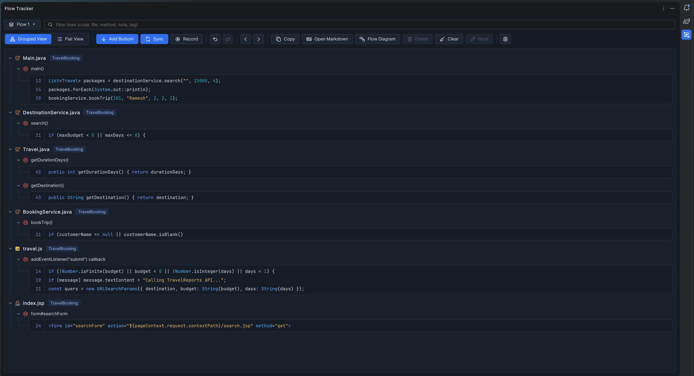


# Prerequisites


Make sure you have the following installed:


- **IntelliJ IDEA 2026.2 or newer** (build `262+`, Community/OSS or Ultimate)
- **JDK 17 or newer** on your `PATH` / `JAVA_HOME` to run Gradle (check with `java -version`)
- **JDK 25** to compile the plugin (optional: Gradle downloads it automatically on the first build if it isn't installed)
- **Gradle 9.6.0** (optional, as this project uses the Gradle wrapper)
- **Internet access** for the first build (Gradle, plugin libraries and, if needed, JDK 25 are downloaded once)

| Component | Version | Where it is set |
|---|---|---|
| IntelliJ IDEA | 2026.2+ (`sinceBuild = 262`) | `build.gradle.kts` |
| Java (plugin code) | 25 | `build.gradle.kts` → `java.toolchain` |
| Gradle | 9.6.0 | `gradle/wrapper/gradle-wrapper.properties` |
| IntelliJ Platform Gradle Plugin | 2.19.0 | `build.gradle.kts` → `plugins` |
| Plugin version | 1.2.1 | `build.gradle.kts` → `version` |
| Plugin ID | `io.github.rameshnr.flowtracker` (never change it once published) | `plugin.xml` → `<id>` |


## Installation


**Just use the plugin:** download `flow-tracker-<version>.zip` from the [latest release](https://github.com/RameshNR/flow-tracker/releases/latest) (don't unzip it), then in IntelliJ IDEA 2026.2+ go to **Settings → Plugins → ⚙️ → Install Plugin from Disk…**, pick the zip and restart the IDE.

**Build it yourself:**

- Copy or clone this repository to any folder, for example `C:/Projects/flow-tracker`
- Open `build.gradle.kts` and set `local("...")` to **your** IntelliJ IDEA installation path (see the next section):
  ```kotlin
  local("C:/Users/<you>/AppData/Local/Programs/IntelliJ IDEA OSS")
  ```
- Open PowerShell in the `flow-tracker` folder (the one that contains `gradlew.bat`)
- Start a sandbox IntelliJ with the plugin installed (the first run takes a few minutes):
  ```shell
  .\gradlew.bat runIde
  ```
- In the sandbox IDE, open a Java project, then open **Flow Tracker** from the right-hand tool window bar
- Hover a line in a source file (for example a `.java`, `.kt`, `.jsp`, `.js` or `.tld` file) and click the **+** in the gutter

To build the installable plugin instead, see [Build the plugin](#build-the-plugin).


## Find your IntelliJ IDEA installation path


The build compiles against the IntelliJ IDEA that is installed on your machine. `local("...")` in `build.gradle.kts` must point to the **installation folder**: the folder that contains `product-info.json` and the `bin` and `lib` folders.

> ⚠️ `C:/Users/<you>/AppData/Roaming/JetBrains/IdeaIC2026.2` is **not** the installation. It is IntelliJ's settings folder, and using it fails with `Cannot resolve 'product-info.json'`.

Any of these ways works:

**1. PowerShell: search the usual locations**

```powershell
Get-ChildItem "$env:LOCALAPPDATA\Programs", "C:\Program Files\JetBrains", "$env:LOCALAPPDATA\JetBrains\Toolbox\apps" `
  -Filter product-info.json -Recurse -Depth 3 -ErrorAction SilentlyContinue |
  ForEach-Object { "{0}  ->  {1}" -f (Get-Content $_.FullName -Raw | ConvertFrom-Json).version, $_.DirectoryName }
```

Each line shows a version and its folder. Pick a `2026.2.x` folder.

**2. From the running IDE (Task Manager)**

- Start IntelliJ IDEA
- Open **Task Manager** → **Details** tab → right-click `idea64.exe` → **Open file location**
- Explorer opens the `bin` folder. The installation path is its **parent** folder.

**3. From the Start menu shortcut**

- Start menu → right-click **IntelliJ IDEA** → **Open file location**
- Right-click the shortcut → **Properties** → **Target** shows `...\bin\idea64.exe`. The installation path is everything before `\bin`.

**4. JetBrains Toolbox**

- Open Toolbox → click **⋮** next to IntelliJ IDEA → **Show in Explorer** (or **Settings → Install location**)

**Typical locations**

| Installed with | Typical installation path |
|---|---|
| JetBrains installer (current user) | `C:/Users/<you>/AppData/Local/Programs/IntelliJ IDEA OSS` |
| JetBrains installer (all users) | `C:/Program Files/JetBrains/IntelliJ IDEA Community Edition 2026.2` |
| JetBrains Toolbox | `C:/Users/<you>/AppData/Local/JetBrains/Toolbox/apps/...` |

Check the folder: it must contain `product-info.json`. Write the path in `build.gradle.kts` with forward slashes `/`.


## Build the plugin


```shell
.\gradlew.bat clean buildPlugin
```

The installable plugin is written to:

```
build\distributions\flow-tracker-1.2.1.zip
```

Install it in IntelliJ IDEA:

- **Settings** → **Plugins** → ⚙️ → **Install Plugin from Disk…**
- Select `build\distributions\flow-tracker-1.2.1.zip`
- Restart the IDE when asked

To release a new version, change `version = "1.2.1"` in `build.gradle.kts`, add its change notes in `plugin.xml`, and build again.


## Commands


Open this README in IntelliJ IDEA and click the ▶ icon next to a block to run it in the terminal.

Run in a sandbox IDE:

```shell
.\gradlew.bat runIde
```

Build the plugin zip:

```shell
.\gradlew.bat clean buildPlugin
```

Quick compile check:

```shell
.\gradlew.bat compileJava
```

Run the unit tests (see [Tests](#tests)):

```shell
.\gradlew.bat test
```

Remove build output:

```shell
.\gradlew.bat clean
```

Stop Gradle background processes:

```shell
.\gradlew.bat --stop
```

On macOS/Linux use `./gradlew` instead of `.\gradlew.bat`.


## Using Flow Tracker


**Adding and removing lines**

- Hover a line in a supported file and click **+** in the gutter. Click the green marker to remove the line.
- Or right-click in the editor → **Add to Flow Tracker** (`Ctrl+Alt+Shift+A`, also under **Tools → Flow Tracker**): adds the caret line, or every line of the selection (all carets), as one undo step. On a saved line without a selection it reads **Remove from Flow Tracker**.
- Saved lines show their **step number** in the gutter (in the order the panel shows them). Hover the number for the method, tag and note.
- Saved lines follow your edits: add or remove lines above them and their line numbers move with the code (in both views, while the file is open in an editor).
- **Add Bottom ↓ / Add Top ↑**: where new lines go.
- **Undo / Redo**: revert adding, deleting and clearing lines. Hover them to see what they will change.

**Supported files**

| Files | What Flow Tracker knows about a line |
|---|---|
| `.java`, `.groovy`, `.gradle` | Class and method from the IDE's code model; Sync and the diagrams follow calls |
| `.kt`, `.kts` | Class and function (through UAST); Sync and the diagrams follow calls |
| `.js`, `.jsx`, `.mjs`, `.cjs`, `.ts`, `.tsx` | Enclosing class and function, or the callback it is in, e.g. `addEventListener("submit") callback`. Calls between saved functions (e.g. a submit handler calling `validate()`) get arrows |
| `.jsp`, `.jspf`, `.jspx`, `.tag`, `.tagx` | The method in a `<%! %>` declaration, `[scriptlet]`, `[script]`, or the enclosing element, e.g. `form#searchForm`. Calls from the page's Java code (`<% %>`, `<%! %>`, `<%= %>`) to saved Java methods get arrows |
| `.tld` | The tag or function, e.g. `tag status`, with the library's `short-name` as the class |
| `.xml`, `.html`, `.htm`, `.xhtml` | The nearest element with an `id` / `name`, else the nearest element |
| `.properties`, `.yaml`, `.yml`, `.sql` | YAML: the parent keys, e.g. `spring.datasource`; the others: the file only |

Lines outside methods are grouped as `[fields]`, `[imports]` or `[class]` (lines saved by older versions show `[class level]`).

IntelliJ IDEA Community has no parser for JavaScript or JSP, so for web and config files Flow Tracker reads the text. Names are a best effort. Calls from JSP Java code are matched to saved Java methods by name and number of arguments (for example `new DestinationService().search(destination, budget, days)` links the page to `DestinationService.search()`); a name shared by several saved methods with the same number of arguments gets no arrow rather than a wrong one. Calls in JavaScript are matched to saved JavaScript functions by name (a name saved in several files links to the one in the same file). Calls from TLD, XML and config files aren't followed.

**Recycle Bin**

- Everything you delete goes to the Recycle Bin: single lines (from the panel or the gutter), **Clear**, and deleted flows. Open it from **Settings ⚙️ → Recycle Bin**.
- Select items to see their lines, then **Restore**. Lines go back into the flow they came from, at their old places (or into the current flow if that flow is gone). A deleted flow comes back as a flow of its own.
- **Delete Permanently** (or the `Delete` / `Backspace` key) removes the selected items for good, after asking; **Empty Recycle Bin** removes everything. Double-click an item to restore it.
- Undoing a delete takes it back out of the bin. The bin is saved with the project and keeps the latest 500 items.

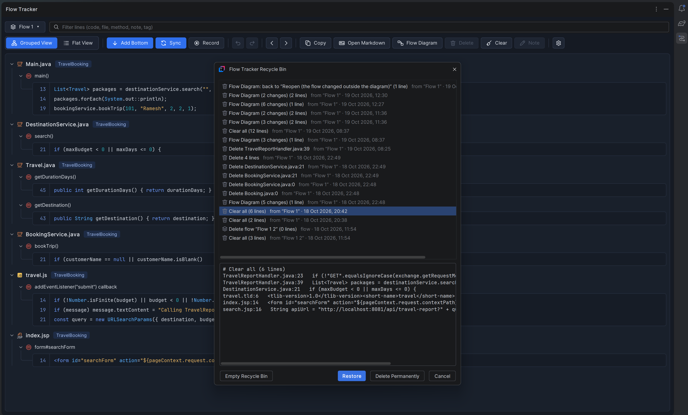

**Record while debugging**

- Click **Record**, then debug as usual. Every line where the debugger stops (a breakpoint or a step) is added at the bottom, in the order it ran. Click **Recording** to stop.
- It also picks up debug sessions that are already running. Recording turns Sync off so the execution order is kept.

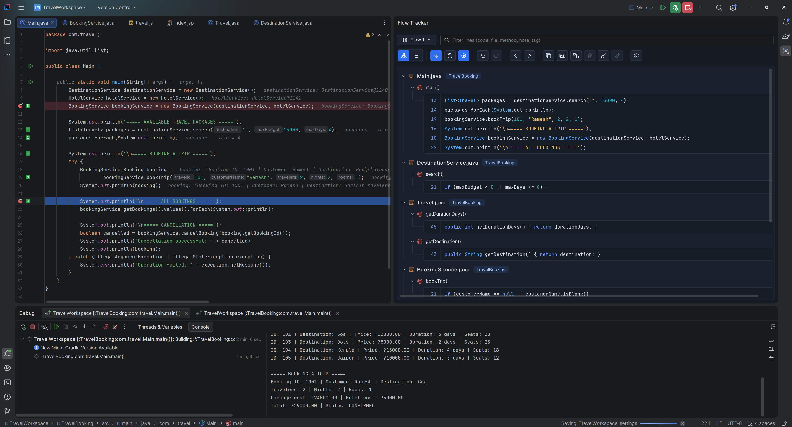

**Flows (and sharing them)**

- Each project can hold as many flows as you like. The flow button at the top left (for example `Flow 1: Checkout bug ▾`) opens the **Flows** popup: click a flow to show it. The current flow is checked, and every flow shows its line count.
- **Reorder**: drag a flow by its handle (⠿), or select it and press `Ctrl+Up` / `Ctrl+Down`. **Copy All Flows** copies the flows in this order.
- **New Flow…** and **Rename Flow…** start the name as `Flow 1: ` (with the flow's number) and put the cursor after it, so you only type the name, e.g. `Flow 1: Checkout bug`. You can delete the prefix if you don't want it. Leaving just the prefix keeps the plain `Flow 1`.
- **Delete Flow** moves the flow to the Recycle Bin, so it can be restored. Deleting the only flow empties it instead.
- **Export Flow…** saves the current flow as a `.flow.json` file. Paths are stored relative to the project folder, so you can commit the file or send it to a teammate.
- **Import Flow…** opens a `.flow.json` file as a new flow. Files are found by relative path first, then by file name. Lines whose file isn't in the project are marked *file missing*.
- Undo / Redo history belongs to the flow it was made in and starts empty when you switch.

**Search**

- The search box above the toolbar shows only lines whose code, file, class, method, note, project or tag contains the text (or whose line number matches).
- While a filter is on, **Copy** copies only the matching lines. Moving lines still works: hidden lines keep their places.

**Views**

- **Grouped View**: file → method → lines, with a project tag on every file.
- **Flat View**: one numbered sequence in flow order.

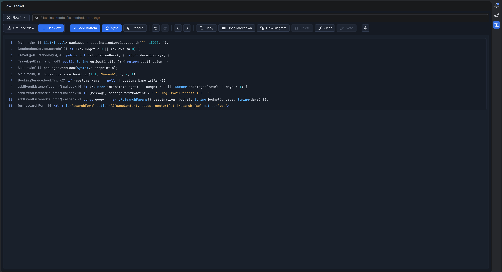

**Rows**

- Hover a row for its action bar: `↑ ↓ | Copy Note | Delete`. Arrows appear only when the row can move, and Note only on code lines.
- Drag to reorder. Right-click for Move, Copy, Note, Jump to Source, Walk from Here, Connect Call To, Tag and Delete. Double-click a line to open it.
- `Ctrl+C` copies the selection, `Delete` removes it.
- **Connect calls by hand**: some calls can't be followed from the code, e.g. a REST / API request that is handled by a controller in another project. Right-click the calling line → **Connect Call To** → pick the method it reaches (the flow's other methods are listed; connected ones are checked, and picking one again removes it). The row shows `→ create()`, and the connection counts like a real call everywhere: Sync order, the Markdown diagrams and the nested Original Log. Connections are saved with the flow and included in **Export / Import**. **Remove Connections from This Line** clears them.
- **Tags**: right-click → **Tag** → 🐞 Bug, ⭐ Important or ❓ Question (or No Tag). Tags show as coloured labels and are included in every copy format.
- **Out-of-date lines**: when a saved line no longer matches the code, it gets an orange warning: *file missing*, *moved to line N* or *code changed*. Hover it for details. Right-click → **Re-link to Code** follows moved code, or takes the line's current code. **Re-link All Moved Lines** fixes every moved line at once.

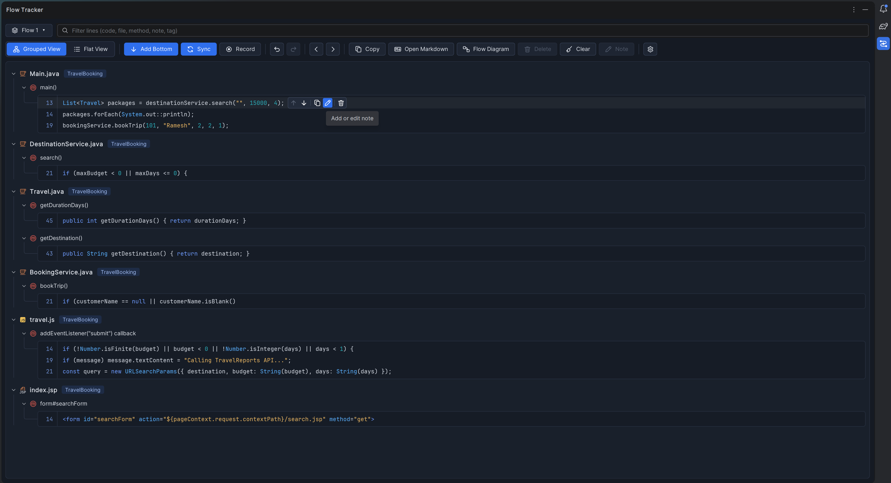

**Flow Diagram (draw and edit the flow)**

- **Flow Diagram** (toolbar, next to **Open Markdown**) opens the flow as a diagram: a box per class or file with its methods (and how many lines each has), solid arrows for calls found in the code and dashed arrows for calls connected by hand.

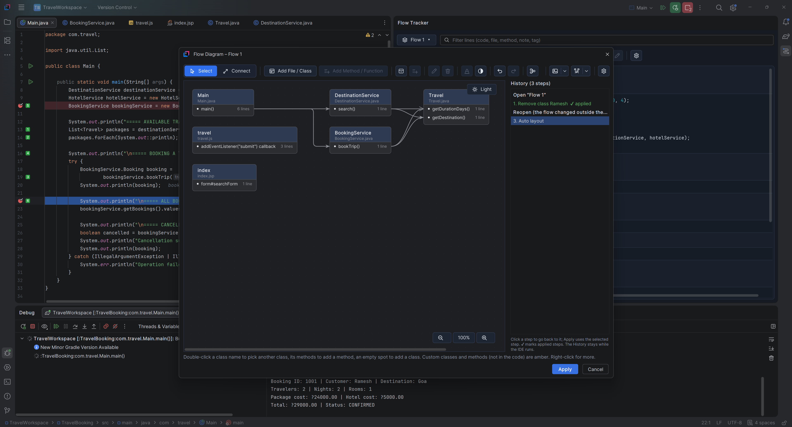

*Toolbar*, from left to right:

| Button | What it does |
|---|---|
| **Select** / **Connect** | Select moves boxes and selects classes, methods and calls. Connect draws a call: drag from a method to the method it calls. |
| **Add File / Class** | Adds a class, or a file such as a JSP page, a script or a TLD, from the project (see below). |
| **Add Method / Function** | Adds a method of the selected class, or a function or block of the selected file, and the lines you pick from its code. |
| **Custom Class / File**, **Custom Method / Function** | Add a class or method that isn't in the code yet. |
| **Rename** (`F2`), **Delete** (`Delete`) | Rename or remove the selected class, method or call. |
| **Format**, **Reset Theme** | Colors, text formats, notes and line styles (see below); Reset Theme gives everything the default look again. |
| **Undo**, **Redo** (`Ctrl+Z` / `Ctrl+Y`) | Step through the History. |
| **Auto Layout** | Arranges the classes in call order, left to right. |
| **Copy PNG ▾**, **Copy Sequence PNG ▾**, **Settings** | At the right end: copy images, and the window's background settings. |

*Adding classes and methods*

- **Add File / Class**: type at least **3 letters** of a class or file name and the matches are listed as you type. Use `*` and `?` as wildcards for the whole name (`*Cruise*.java` finds `OdysseyCruiseProcessor.java`), or put a regular expression between slashes: `/Book.*Service/`. A name that no class of the project has is offered as a **custom class** (the last row, or the only one).
- **Add Method / Function** lists the methods of a class from the code, or a file's functions and blocks (scriptlets, tags, elements), filtered as you type with the same search (`get*`, `*Booking`, `/^(get|set)/`), from the first letter. Pick one, and a second window shows **its code** so you can tick the lines to add. Without ticking any, the method's first line is added so the method is in the flow.
- **Custom Class / File** and **Custom Method / Function** add ones that aren't in the code yet. They and the arrows to and from them are drawn in **amber** (marked *custom*). Code lines can only be picked for classes from the code.
- **Double-click** a class **name** to pick another class of the project for that box (its methods stay, as custom methods of the new class), its **methods** to add a method, or an empty spot to add a class there.
- **Rename a class**: the project's classes that match the new name (also with wildcards or a `/regex/`) are listed as you type; pick one and it takes the box's place. A name no class has makes it a **custom class**. Renaming a method changes its name in Flow Tracker only.
- Right-click a class, a method, a call or an empty spot for the same actions.


*Moving around*

- **Drag a box** to move it. Boxes never cover each other: when a box grows (a longer name, a note, more methods) or is dropped on another, the boxes around it move right or down to make room, and the box you just edited or moved stays put.
- **Lines go around boxes**: a call whose line would run under another box takes a detour through the gaps between the boxes (rounded corners for curved lines, right angles for the others).
- **Drag an empty spot** (or drag with the middle mouse button anywhere) to move the view.
- **Zoom**: the **−**, **100%** and **+** buttons in the bottom right corner zoom out, back to 100% and in (25%–300%). `Ctrl` + mouse wheel zooms around the mouse; `Ctrl+Plus`, `Ctrl+Minus` and `Ctrl+0` work too.
- The **Dark / Light** switch in the top right corner flips the drawing area's background.

*Code panel*

- Click a method and the **code panel** opens under the diagram (it closes when no method is selected). It shows the method's lines in the flow in a read-only editor with the IDE's syntax colors and the file's real line numbers; the flow's lines are highlighted and the rest of the file is folded into `⋯ n lines` (click one to open it).
- **View Full Code** shows the whole file at that method, with the flow's lines still highlighted; **Flow Lines Only** goes back. Drag the divider to give the code more room.

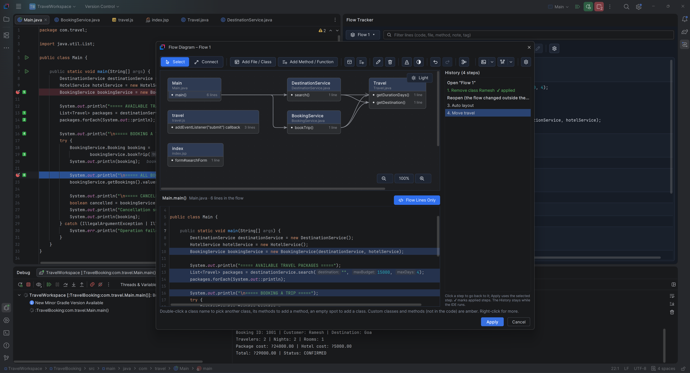

*History, Apply and Cancel*

- Every change is listed on the right. **Undo** / **Redo**, or click a step to go back to it. The History stays after **Apply** and when the window is opened again (while the IDE runs); applied steps are marked ✔. Clicking a step from before an earlier Apply and applying it brings the flow back to that state. A change that leaves the diagram as it is (for example **Auto Layout** clicked again) isn't added.
- **Apply** writes the changes to the flow as **one** step (the Flow Tracker window's **Undo** reverts it); **Cancel** keeps the flow, and the History, as they were (it asks first when there are changes):

  | In the diagram | In the Flow Tracker window |
  |---|---|
  | Add File / Class, Add Method / Function with picked lines | Those code lines, as saved lines |
  | Custom Class / File, Custom Method / Function | A line marked **+** with `// added in Flow Diagram` (no code yet); a custom class has no file |
  | Rename a class or method | Its lines get the new name (in Flow Tracker only; your code doesn't change) |
  | Delete a class or method | Its lines go to the Recycle Bin |
  | Draw a call | A **Connect Call To** connection (calls found in the code can't be removed) |
  | Format, notes, box positions | Saved with the flow (and in **Export / Import**) |

- Lines added in the diagram work everywhere else too: Sync, the Markdown diagrams, the Original Log and Export / Import. The Markdown copy says what isn't in the code yet (*not in the code yet: … added in the Flow Diagram*, and *No code yet* in the line table); the walk-through says so too.

*Format*

**Format** (toolbar, or right-click → **Format Box (and Note)…** / **Format Method (and Note)…** / **Format Line…**) changes how the selection looks and holds its note. Formats, notes and box positions are saved with the flow when you **Apply**, so they come back after a restart; the toolbar's **Undo** reverts them, and **Export / Import** carries them in the `.flow.json` file.

- **A box** (class or file): a **theme**: **Plain** (the default, the diagram's own look), **Light**, **Dark**, or Blue, Green, Amber, Rose, Purple, Teal, Navy, Slate, each with a strong class section, a softer method section and a matching border. Or set its own colors for the **class section** (name, file name, note), the **method section** and the **border**: set one section and the other follows in a matching shade until you set it too. Text turns dark or light by itself so it stays readable on any background (**Auto**). A live preview shows the box while you pick.
- **Text** (class name, file name, method names, notes): **B**old, *I*talic, **U**nderline, **S**trike-through and a color. The B / I / U / S buttons are filled with the accent color while they are on. A box's *Method names* format applies to all its methods; a method's own format (Format Method) wins.
- **Colors**: each color is one button (its swatch and name, ▾). It opens a picker with **Auto**, suggested colors, ten color families in six shades plus greys, your recent colors, a `#RRGGBB` field and **More colors…** (IntelliJ's color chooser); the current color is marked.
- **Notes**: shown right under the class name or the method name. They can have several lines (long ones wrap) and their own text format. Drag the handle under the note box to make it taller or shorter.
- **A call's line**: its **pattern** (automatic, solid, dashed, short dashes, long dashes, dotted, dash-dot, dash-dot-dot, double line, double dashed), **width** (thin to heavy), **shape** (curved, straight, elbow), **arrow** (sharp arrow, triangle, open arrow, diamond, dot, none) and **color**, each shown as a picture, with a live preview. *Use this line for every call in the diagram* styles all lines at once.
- **Reset**: the Format Box, Format Method and Line windows have a **Reset** button (bottom left) that puts every option back to the default (the Plain theme, usual text formats, the usual line) before you press OK; the note text stays. **Reset Theme** in the toolbar does the same for every class, method and line at once, as one step you can undo; notes, calls and positions stay.

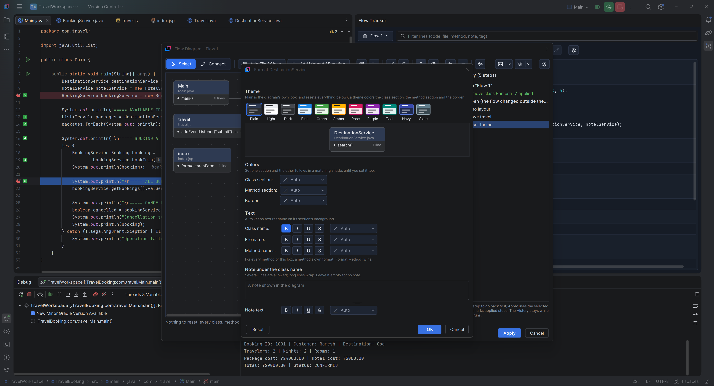

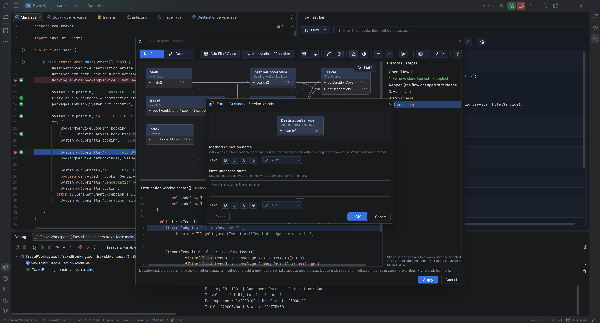

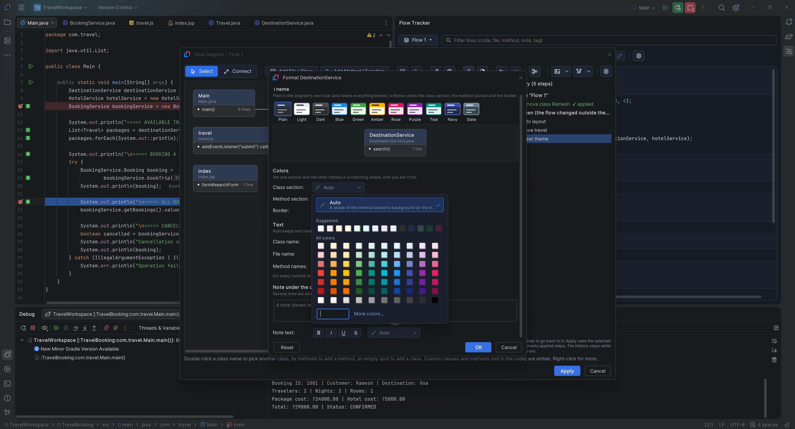

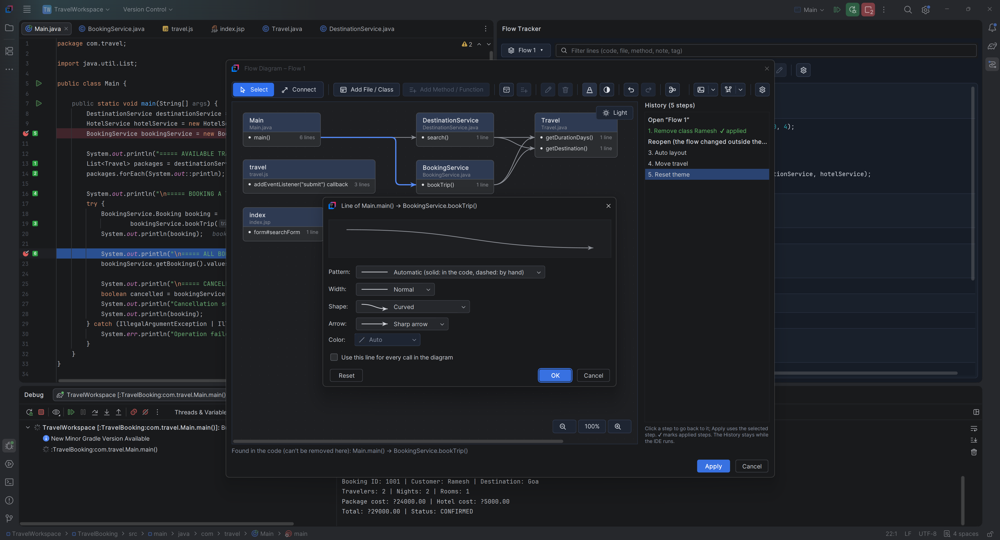

*Images and settings*

- **Copy PNG** copies the diagram as an image; **Copy Sequence PNG** copies its calls as a numbered sequence diagram image (participants, calls and returns). They paste into documents, chats and image editors, always at full size whatever the zoom. Each is a split button: click it for the default background, or its **▾** for **Copy with Light Background** / **Copy with Dark Background**.
- **Settings** (the gear at the right end) sets the **default background of the copied images** (light or dark) and the **diagram window's background** (same as Flow Tracker / the IntelliJ theme, light or dark). Its popup opens below the button, lined up with its right edge. Both settings are remembered for all projects.

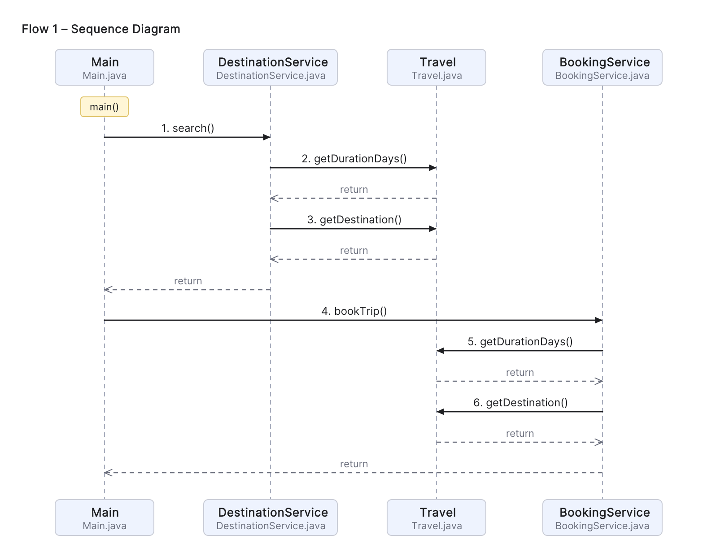

**Walk-through**

- **Next Step** / **Previous Step** (toolbar arrows, or `Alt+]` / `Alt+[` anywhere in the IDE) open each saved line in the editor in the order the panel shows them. A hint shows the step number, the method, the tag and the note.
- Select a line, or right-click → **Walk from Here**, to continue from it. The actions are also under **Tools → Flow Tracker**, and you can rebind the shortcuts in **Settings → Keymap**.

**Sync (call order)**

- With **Sync** on, a method comes first and the methods it calls follow right after the calling line, across files.
- Moving anything by hand turns Sync off. Click **Sync** again to re-sort.

**Settings (⚙️)**

| Option | What it does | Default |
|---|---|---|
| Sync Files | Automatic call order | On |
| Optimize Flat View Log | Flat View copy as a compact `[project]` / file / method log with `line \| code` rows | Off |
| Copy as Markdown | Copy as a `.md` document: summary table, Mermaid diagrams of the real calls, each method's lines as a table with syntax-highlighted code, and the **Original Log** at the end (see below) | On |
| Sequence Diagram | In the Markdown copy, draw the calls as a Mermaid `sequenceDiagram` (files calling each other, with returns) instead of a `flowchart`. It follows the real calls from each entry method, whatever order the lines are listed in | On |
| Copy All Flows | When on, the toolbar's **Copy** button copies every flow, one after the other under its name, in the Flows popup's order and the copy format chosen above. `Ctrl+C` still copies the selected lines | On |
| Nest Calls in Original Log | In the Markdown copy's Original Log, each called method's lines go right under the line that calls it, indented like a call stack (see below) | On |
| Use IntelliJ Theme | Take every Flow Tracker color from the current IntelliJ theme and editor color scheme: the panel, buttons, popups, highlighted code and the Flow Diagram. Off: Flow Tracker's own colors (light and dark). Applies to all projects | Off |
| Recycle Bin | Restore or permanently delete deleted lines and flows | |
| Info | Help dialog with all features, with a carousel of screenshots at the top | |

*Optimize Flat View Log* and *Copy as Markdown* exclude each other.

**Open Markdown** (the toolbar button next to **Copy**) opens the flow as a Markdown document in the editor, so the preview shows the diagrams right away: always as Markdown, whatever the copy setting, and all flows when *Copy All Flows* is on. The document is a scratch file (**Project view → Scratches and Consoles**), so you can keep it, edit it or save it elsewhere.

In the Markdown copy, each method's lines are a table with the line number in its own column, the code (syntax highlighted), and a Note column (tag and note) when any line has one:

| Line | Code | Note |
|---:|---|---|
| 21 | <code><span style="color:#3574F0;font-weight:600">if</span> (customerName == <span style="color:#3574F0;font-weight:600">null</span> &#124;&#124; customerName.isBlank()</code> | 🐞 Bug · _Storing the Data_ |
| 27 | <code><span style="color:#3574F0;font-weight:600">if</span> (nights &gt;= travel.getDurationDays()) {</code> |  |

The code is colored with the same rules as the panel (keywords, types, strings, numbers, comments; tags and attribute values in markup) using inline HTML colors. IntelliJ's Markdown preview, VS Code and most editors show the colors; GitHub removes inline colors and shows the same table with plain code.

In the Markdown diagrams, each box or column is titled with the file name and extension (for example `BookingService.java`, `travel.js`, `travel.tld`). Code that doesn't call between groups (for example a Java service, a script and a tag library) gets one diagram per group; a JSP page that calls Java methods is in the same diagram as them. Lines outside methods (fields, imports) are left out of the diagrams but stay in the details.

Each flow's Markdown ends with an **Original Log** section: the lines as plain text in a text block. With **Copy All Flows** on, every flow ends with its own Original Log.

With **Nest Calls in Original Log** on (the default), each called method's lines sit right under the line that calls it, indented like a call stack. Code lines sit one tab (4 spaces) under their method, at every level, and an empty line closes each called block. A called method in the same file as its caller shows just its method name (no file line); one in another file shows the file name, and the project only when it differs from the calling file's project (so a call into another project, e.g. an API, stands out). Grouped View:

```text
Main.java  (TravelBooking)
main()
    8: DestinationService destinationService = new DestinationService();
    13: List<Travel> packages = destinationService.search("", 15000, 4);
        DestinationService.java
        search()
            21: if (maxBudget < 0 || maxDays <= 0) {

    14: packages.forEach(System.out::println);
    26: boolean cancelled = bookingService.cancelBooking(booking.getBookingId());
        BookingService.java
        cancelBooking()
            55: Booking booking = bookings.get(bookingId);

    27: System.out.println("Cancellation successful: " + cancelled);
```

Flat View gives the same nesting as numbered steps:

```text
1. Main.main():8 | DestinationService destinationService = new DestinationService();
2. Main.main():13 | List<Travel> packages = destinationService.search("", 15000, 4);
    3. DestinationService.search():21 | if (maxBudget < 0 || maxDays <= 0) {

4. Main.main():14 | packages.forEach(System.out::println);
```

A call from a line you didn't save goes under the saved line before it. A method called from several places is shown at its first call; the other calls point to it (`↳ search()  (DestinationService.java, shown above)` or `(see step 3)`).

With the switch off, the Original Log is the plain copy of the current view: the file → method → lines list (Grouped) or the numbered steps (Flat), exactly what **Copy** gives with *Copy as Markdown* off.

A Markdown copy with the sequence diagram, rendered in IntelliJ's Markdown preview:

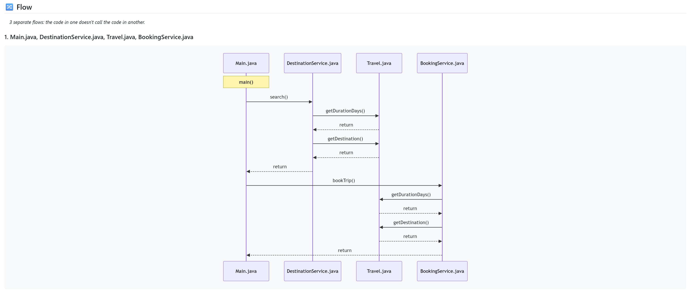

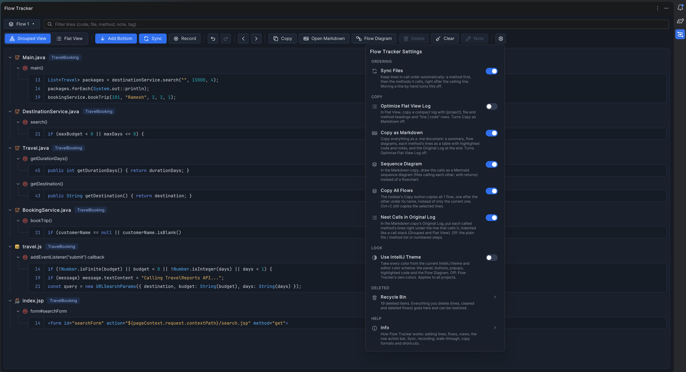

Flows, settings and the Recycle Bin are saved per project in `.idea/workspace.xml`. Lines saved by version 1.0.0 open as **Flow 1**. The same help is in the plugin under **Settings ⚙️ → Info**.


## Screenshots


The image carousel at the top of a plugin's page in **Settings → Plugins** comes from **JetBrains Marketplace**: it shows the screenshots uploaded on the plugin's Marketplace page (**Edit plugin → Media**). It can't be set in `plugin.xml`, and a plugin installed from disk shows no carousel. To get one:

1. Publish the plugin on [JetBrains Marketplace](https://plugins.jetbrains.com) (see [Publish to JetBrains Marketplace](#publish-to-jetbrains-marketplace)).
2. On the plugin's Marketplace page, open **Edit → Media** and upload the screenshots (PNG or JPG; JetBrains recommends 1280×800). Their order there is the carousel order.
3. The IDE shows the carousel for everyone who views the plugin in **Settings → Plugins → Marketplace**.

**Plugin icon.** The icon in **Settings → Plugins** is `src/main/resources/META-INF/pluginIcon.svg` (40×40) and `pluginIcon_dark.svg` for dark themes. IntelliJ shows a generic plug icon when they're missing.

**Images in the Overview tab.** The text on the plugin's **Overview** tab comes from `src/main/plugin-description.html` (Gradle puts it into `plugin.xml`). It has a spot for each screenshot, but the IDE only shows description images from a web address, so they appear once the images are online:

1. Put the files from `src/main/resources/images/` in a public web folder, for example by pushing this project to a public GitHub repository.
2. Set that folder's address in `gradle.properties`:
   ```properties
   pluginImagesUrl=https://raw.githubusercontent.com/<owner>/<repo>/main/src/main/resources/images
   ```
3. Rebuild the plugin and install it again:
   ```shell
   .\gradlew.bat clean buildPlugin
   ```

While `pluginImagesUrl` is empty, the description is built without images (no broken pictures). The images show one below another in the text; a sliding carousel there needs JetBrains Marketplace (below).

Inside the plugin, **Settings ⚙️ → Info** opens with a carousel of the screenshots in `src/main/resources/images/` (dots, arrows, the Left / Right keys, and it moves on every few seconds unless the mouse is over it).

These are the screenshots in `src/main/resources/images/`. To update one, replace the file with the same name: this README, the plugin's Overview tab and the Info carousel pick it up from there. JetBrains recommends 1280×800 for the Marketplace carousel; use the same files there.

| File | Shows | Used in |
|---|---|---|
| `flow-tracker-grouped-view.png` | Grouped View: files, methods and saved lines with syntax colors and project tags | README, Overview tab, Info |
| `flow-tracker-flat-view.png` | Flat View with step numbers | README, Overview tab, Info |
| `flow-tracker-hover-actions.png` | The hover action bar on a row (↑ ↓, Copy, Note, Delete) | README, Overview tab, Info |
| `flow-tracker-record.png` | Record on, with the debugger paused | README, Info |
| `flow-tracker-recycle-bin.png` | The Recycle Bin with an item selected | README, Info |
| `flow-tracker-settings.png` | The Settings popup, with the **Use IntelliJ Theme** switch | README, Overview tab, Info |
| `flow-tracker-markdown-copy.png` | A Markdown copy rendered in the preview, with the call diagram | README, Overview tab, Info |
| `flow-tracker-flow-diagram.png` | The Flow Diagram window: toolbar, class boxes with methods, call arrows, the History and the zoom buttons | README, Overview tab, Info |
| `flow-tracker-diagram-code-panel.png` | A method selected in the diagram and its code panel below | README, Overview tab, Info |
| `flow-tracker-diagram-themes.png` | A formatted diagram: box themes, notes under class and method names, line styles | README, Overview tab, Info |
| `flow-tracker-diagram-format-box.png` | The Format Box window: themes, section and border colors, text formats, the note and the preview | README, Info |
| `flow-tracker-diagram-color-picker.png` | The color picker popup: Auto, suggested colors, the color grid, recent colors and `#RRGGBB` | README, Info |
| `flow-tracker-diagram-format-line.png` | The Line window: pattern, width, shape, arrow and color with the preview | README, Info |
| `flow-tracker-diagram-sequence.png` | An image made by Copy Sequence PNG: participants, numbered calls and returns | README, Info |

To add a screenshot, put the file in `src/main/resources/images/` and add it to this table, to the README section it belongs to, to `FlowCarousel.SLIDES` (the Info carousel) and, if it should be on the Overview tab, to `src/main/plugin-description.html`.


## Publish to JetBrains Marketplace


The plugin passes the IntelliJ Platform Gradle plugin's checks for Marketplace (`.\gradlew.bat verifyPluginProjectConfiguration verifyPluginStructure`). Its ID is `io.github.rameshnr.flowtracker`: Marketplace doesn't accept `com.example` IDs, and an ID can't change after the first upload.

**First version (by hand, once).** JetBrains requires the first upload of a new plugin through the website:

1. Sign in at [plugins.jetbrains.com](https://plugins.jetbrains.com) with your JetBrains account and open **Upload plugin** ([plugins.jetbrains.com/plugin/add](https://plugins.jetbrains.com/plugin/add)).
2. Build the zip (`.\gradlew.bat clean buildPlugin`) and upload `build\distributions\flow-tracker-<version>.zip`.
3. Fill in the form: vendor **RameshNR** (the same name as `<vendor>` in `plugin.xml`), license **MIT** with the URL `https://github.com/RameshNR/flow-tracker/blob/main/LICENSE`, source code `https://github.com/RameshNR/flow-tracker`, category / tags (e.g. *Code tools*, *Navigation*).
4. Submit. JetBrains reviews new plugins before they appear (usually a couple of working days); you get an e-mail.
5. On the plugin's page, **Edit → Media**: upload the screenshots from `src/main/resources/images` for the carousel in **Settings → Plugins**.

**Later versions (from Gradle).** The secrets come from environment variables, never from files in the project.

1. Create a **permanent token**: [plugins.jetbrains.com](https://plugins.jetbrains.com) → your profile → **My Tokens**.
2. Optional: a signing certificate ([Plugin Signing](https://plugins.jetbrains.com/docs/intellij/plugin-signing.html)). Marketplace accepts unsigned plugins too.
3. In PowerShell, set the variables for the current window, bump `version` in `build.gradle.kts`, and publish:
   ```powershell
   $env:PUBLISH_TOKEN = "<your Marketplace token>"
   $env:CERTIFICATE_CHAIN = Get-Content -Raw chain.crt      # only when signing
   $env:PRIVATE_KEY = Get-Content -Raw private.pem          # only when signing
   $env:PRIVATE_KEY_PASSWORD = "<key password>"             # only when signing
   ```
   ```shell
   .\gradlew.bat publishPlugin
   ```


## Project structure


```text
src/main/java/com/example/flowtracker/
├── model/     Data and settings: a saved line (FlowEntry), tags, the per-project store with flows, undo and the
│              Recycle Bin (FlowStore), the IDE-wide look (FlowLook), .flow.json export / import (FlowTransfer),
│              out-of-date checks (FlowCheck) and project names (FlowProjects)
├── code/      Understanding code: supported file types (FlowLang), class / method of a line (FlowCapture, and
│              FlowOutline for JSP, JavaScript, TLD... read as text), call order (FlowSync) and the project search
│              used by the Flow Diagram (FlowCodeSearch)
├── editor/    Editor integration: the gutter + and step numbers (LineHoverHandler, AddedIcon,
│              FlowEditorFactoryListener), Add to Flow Tracker (FlowAddAction), the walk-through (FlowWalk) and
│              Record (FlowRecorder)
├── copy/      Copy formats: text (FlowFormat), Markdown with diagrams (FlowMarkdown), the nested Original Log
│              (FlowCallLog), code colors (CodeHighlighter), and the clipboard / Open Markdown (FlowCopy)
├── diagram/   The Flow Diagram window (FlowDiagramDialog), its model and History (FlowDiagram), drawing and PNG
│              images (FlowDiagramPainter), Format windows (FlowDiagramFormat), saved looks (FlowDiagramLook), the
│              code panel (FlowDiagramCode) and the class / method / line pickers (FlowCodePicker)
└── ui/        The tool window (FlowToolWindowFactory), toolbar and buttons (FlowToolbar, FlowButton), colors and
               icons (FlowTheme), the Flows and Settings popups (FlowMenuPopup, FlowSettingsPopup), Info with its
               screenshot carousel (FlowInfoDialog, FlowCarousel) and the Recycle Bin (FlowRecycleBinDialog)

src/main/resources/
├── META-INF/  plugin.xml (actions, tool window, change notes) and the plugin icon
├── icons/     Toolbar icons (tb_*.svg)
└── images/    Screenshots for the README, the Overview tab and the Info carousel

src/test/java/com/example/flowtracker/
├── Fixtures.java                       Shared test data
├── model/ code/ copy/ diagram/         Tests next to the package they test
src/test/resources/fixtures/            Sample JSP, JavaScript and TLD files
```

Classes used only inside their package stay package-private; what another package needs is `public`. The plugin's entry points in `plugin.xml` are `ui.FlowToolWindowFactory`, `editor.FlowEditorFactoryListener`, `editor.FlowAddAction` and `editor.FlowWalk$Next` / `$Previous`.


## Tests


`src/test` holds JUnit 5 tests for everything that doesn't need a running IDE: the Markdown diagrams and line tables, the Original Log, reading JSP / JavaScript / TLD files (with sample files in `src/test/resources/fixtures`), JSP → Java and JavaScript calls, the Recycle Bin and undo, flows and their order, copy formats, labels, file types and highlighting, and the Flow Diagram (building it from a flow, Apply, the History, layout without overlaps, lines around boxes, formats, themes and Reset Theme, and the PNG images).

```shell
.\gradlew.bat test
```

The report is written to `build\reports\tests\test\index.html`.


## License


[MIT](LICENSE) © 2026 RameshNR.


## Troubleshooting


| Problem | Fix |
|---|---|
| `Cannot resolve 'product-info.json'` | `local(...)` doesn't point to an IntelliJ installation. See [Find your IntelliJ IDEA installation path](#find-your-intellij-idea-installation-path). |
| `'.\gradlew.bat' is not recognized` | Run the command in the folder that contains `gradlew.bat`. |
| Java 25 / toolchain download fails | Check internet access (needed once) or install JDK 25 yourself. |
| Flow Tracker isn't visible in the sandbox | **View → Tool Windows → Flow Tracker**. |
| Sync doesn't link two methods | Both methods need a saved line. Set a Project JDK in the sandbox project (*Setup SDK*). |
| Lines show *moved to line N* | Lines follow edits made in an open editor. Changes made elsewhere (a Git pull, another tool, a closed file) can move code away from its saved line: right-click → **Re-link All Moved Lines**. |
| Record adds nothing | Recording only adds lines in supported files, and only when the debugger actually stops (a breakpoint or a step). |
| A diagram arrow is missing | Arrows link only methods that have a saved line, and only calls the code shows (Java, Kotlin, Groovy, JSP Java code, JavaScript). For anything else, such as an API call into another project, right-click the calling line → **Connect Call To**. Set a Project JDK so calls resolve; Sync falls back to method names (and, for JSP, name plus number of arguments) when they don't. A name shared by several saved methods gets no arrow. |
| `Alt+]` / `Alt+[` / `Ctrl+Alt+Shift+A` do nothing | Another plugin or keymap may use them. Rebind **Next Flow Step** / **Previous Flow Step** / **Add to Flow Tracker** in **Settings → Keymap**. |
| `runIde` prints SEVERE / WARN lines | Most come from IntelliJ itself (e.g. `LoadingState`, `ActionUpdater`, JCEF, Markdown preview) and are harmless. `idea.log` (in `.intellijPlatform\sandbox\...\log_runIde`) keeps old runs: delete it before a run, then search it for `Plugin to blame: Flow Tracker` to find the plugin's own errors. `> :runIde` stays at *EXECUTING* while the sandbox IDE is open. |
| The sandbox IDE misbehaves after many runs | Close it, delete `.intellijPlatform\sandbox`, and run the sandbox again (see [Commands](#commands)). |
